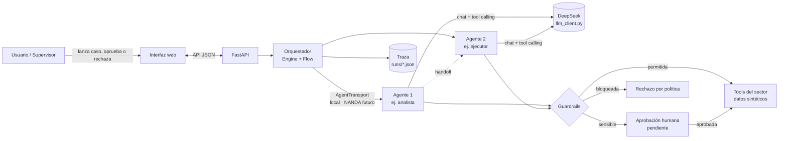

# Hack AI Agents — Agentes de IA con control humano

Proyecto para el hackathon **"Hack AI Agents Impact"** (NTT DATA x Sundai LATAM).
Sistema multi-agente (FastAPI + DeepSeek) que analiza casos operativos, consulta datos, ejecuta
acciones con reglas de negocio y pide **aprobación humana** para las acciones sensibles, dejando
una **traza completa** de cada paso.

> Sector: _[completar: Banca / Minería / Manufactura]_

## Problema

_[Completar el día del evento: quién tiene el problema, qué proceso es lento, caro o propenso a errores, y cuánto cuesta hoy.]_

## Solución

Un equipo de agentes de IA con roles distintos que resuelve el caso de punta a punta:

- **Analiza** la solicitud y consulta los datos necesarios mediante herramientas (tools).
- **Decide** qué acciones corresponden y **traspasa** el trabajo al agente que las ejecuta.
- **Respeta reglas** (montos máximos, acciones prohibidas, validaciones de negocio) antes de ejecutar.
- **Pide aprobación humana** para acciones sensibles: nada crítico se ejecuta sin una persona.
- **Deja trazabilidad**: cada razonamiento, tool, resultado y decisión queda registrado y visible.

## Arquitectura



Despliegue: `Internet → Caddy (:80/:443) → app FastAPI (:8000)` con Docker Compose.

### Estructura

```
app/
  main.py            FastAPI: /, /health, /api/*
  api.py             API JSON (lanzar casos, ver trazas, aprobar/rechazar)
  llm_client.py      ÚNICO acceso al LLM (DeepSeek, SDK openai) — reintentos, timeouts, JSON tolerante
  agents/
    agent.py         Agent (config) + AgentSession (loop con tool use, reanudable)
    flow.py          Flow: agentes + reglas de traspaso (secuencial / condicional)
    engine.py        Orquestador: estado compartido, handoffs, aprobaciones, hilos
    tools.py         Registro de tools con decorador @tool
    guardrails.py    Reglas antes de ejecutar cada tool
    transport.py     AgentTransport (punto de extensión para NANDA)
    trace.py         Run / Step / Approval + persistencia en runs/
  static/index.html  Interfaz de demo (HTML + JS, sin dependencias externas)
sectors/
  ui_base.json       Textos comunes de la interfaz
  generico|banca|mineria|manufactura/
    __init__.py      Agentes, FLOW y CASO_EJEMPLO
    tools.py         Tools y validadores del sector
    guardrails.json  Reglas
    ui.json          Textos de la interfaz del sector
    data/*.json      Datos sintéticos
scripts/
  smoke_llm.py       Prueba del LLM (simple, tool calling, thinking on/off)
  run_example.py     Caso de ejemplo completo por consola
  verify_remote.py   Verificación de un despliegue desde fuera
caddy/               Configuración HTTPS (sslip.io) y plan B HTTP
deploy.sh            Despliegue repetible en el VPS
```

## Cómo correrlo

```bash
cp .env.example .env          # completar DEEPSEEK_API_KEY y elegir SECTOR
```

**Local (Python):**
```bash
python -m venv .venv && source .venv/bin/activate     # Windows: .venv\Scripts\activate
pip install -r requirements.txt
uvicorn app.main:app --reload                         # http://127.0.0.1:8000
```

**Docker:**
```bash
docker compose up --build -d                          # app en 127.0.0.1:8000, Caddy en 80/443
```

**Pruebas rápidas:**
```bash
python scripts/smoke_llm.py                 # el LLM responde y hace tool calling
python scripts/run_example.py               # caso de ejemplo completo (aprueba automáticamente)
python scripts/run_example.py --rechazar    # mismo caso, rechazando la acción sensible
SECTOR=banca python scripts/run_example.py  # probar otro pack
```

**Despliegue:** ver [DEPLOY.md](DEPLOY.md). Redesplegar:
`git push vps main && ssh root@<IP> 'cd ~/hacktaton && ./deploy.sh'`

### Configuración (.env)

| Variable | Uso |
|---|---|
| `DEEPSEEK_API_KEY` | Clave de DeepSeek (nunca se sube al repo ni a la imagen) |
| `DEEPSEEK_MODEL` | `deepseek-flash` (por defecto) o `deepseek-v4-pro` |
| `SECTOR` | `generico` · `banca` · `mineria` · `manufactura` |
| `LLM_THINKING` | `false` por defecto; se puede activar por agente |
| `LLM_TIMEOUT`, `LLM_MAX_RETRIES` | Robustez del cliente LLM |
| `APP_HOST`, `CADDY_MODE` | Despliegue: host sslip.io y modo `https` / `http` |

## Cómo agregar una tool

En `sectors/<sector>/tools.py`:

```python
@tool(description="Consulta el stock de un producto.",
      params={"sku": "Código del producto"},
      sensitive=False)                 # True -> requiere aprobación humana
def consultar_stock(sku: str) -> dict:
    return {"sku": sku, "stock": 120}
```

El esquema JSON se genera desde la firma (tipos `str`, `int`, `float`, `bool`). Luego agrega el
nombre a la lista `tools=[...]` del agente que la usará y su etiqueta en `ui.json` (`tool_names`).

**Validación de negocio previa** (bloquea si devuelve un mensaje):

```python
@validator("crear_orden")
def entidad_activa(args: dict) -> str | None:
    return None if ENTIDADES[args["entidad_id"]]["estado"] == "activo" else "Entidad no activa"
```

**Reglas sin código** en `sectors/<sector>/guardrails.json`:

```json
{
  "blocked_tools": ["eliminar_cliente"],
  "max_values": {"monto": 50000},
  "approval_thresholds": {"monto": 10000},
  "require_approval_tools": ["enviar_notificacion"]
}
```

## Cómo agregar agentes y flujos

En `sectors/<sector>/__init__.py`:

```python
analista = Agent(name="analista", role="Analizas ... y traspasas al ejecutor ...",
                 tools=["consultar_x"], handoffs=["ejecutor"])          # handoff decidido por el LLM
ejecutor = Agent(name="ejecutor", role="Ejecutas ...", tools=["crear_y"],
                 thinking=True)                                         # thinking solo en este agente
auditor  = Agent(name="auditor", role="Revisas lo ejecutado ...")

FLOW = Flow(
    agents=[analista, ejecutor, auditor],
    start="analista",
    next={"ejecutor": "auditor"},                                       # secuencial
    # next={"ejecutor": lambda state: "auditor" if "monto" in state["outputs"]["ejecutor"] else None},
)
```

- **Handoff condicional (LLM):** un agente con `handoffs=[...]` recibe la tool `transferir_a` y decide él mismo traspasar.
- **Secuencial / condicional por regla:** `next` con un nombre o una función sobre el estado compartido.
- **Estado compartido:** `run.state` guarda la solicitud original y la salida de cada agente; el siguiente agente la recibe.
- **NANDA:** implementar `AgentTransport.deliver()` (ver `app/agents/transport.py`) y pasar `Engine(transport=...)`.

## API

| Método | Ruta | Descripción |
|---|---|---|
| GET | `/health` | Estado, sector y modelo |
| GET | `/api/ui` | Textos de la interfaz + caso de ejemplo |
| POST | `/api/runs` | Lanza un caso `{"input": "..."}` (vacío = ejemplo) |
| GET | `/api/runs/{id}` | Traza, aprobaciones, estado y resultado |
| POST | `/api/approvals/{id}` | `{"approved": true, "comment": "..."}` |

## Código

Repositorio: _[completar URL pública]_
